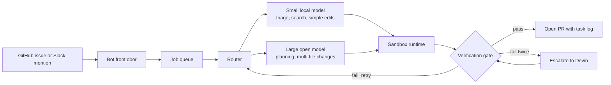

# TierDev (working title)

An open-source coding agent that runs on open-weight models and only pays for a proprietary agent (Devin) when the open stack fails.

**Goal:** match a large share of Devin's resolve rate at a fraction of the cost per task, self-hostable, with numbers anyone can check.

> **Status: planning.** The architecture and eval plan below are final. The results table is empty on purpose and will be filled in as runs finish. Nothing in it is estimated.

## Why this exists

Agent products bundle a model, a harness, and a price. This project pulls them apart:

- Use a **fixed, open harness** so results are comparable.
- Route each task to the **cheapest model that can handle it**.
- Use Devin as the **escalation tier and the baseline**, not the default.

## Architecture



| Layer | Choice | Notes |
|---|---|---|
| Agent loop | OpenHands (fork) | Do not rebuild the loop. OpenDevin is now OpenHands. |
| Model gateway | LiteLLM | One OpenAI-compatible endpoint, routing, retries, per-task cost tracking |
| Serving | Hosted open-weight APIs for big models, vLLM or SGLang as the self-host path, Ollama for local dev only | Large MoE models need multi-GPU, so hosted endpoints are used for the demo |
| Execution | Disposable Docker or Kubernetes sandbox per task | No shared state between tasks |
| Queue | Redis or Temporal | Resumable, parallel runs |
| Bots | GitHub App and Slack bot | Mention the bot on an issue, get a PR |
| Observability | OpenTelemetry, one trace per agent step | Tokens, latency, and cost per task |

## Model roster

| Tier | Model | Role | Reported SWE-bench Verified |
|---|---|---|---|
| Large | GLM 5.2 | Planning, multi-file changes | 78.7 |
| Large | Kimi K2.6 | Planning, multi-file changes | 80.2 |
| Large | DeepSeek V4 Pro | Default workhorse, lowest cost | 77.6 |
| Small | Devstral Small 2 (24B) | Triage, file search, simple edits | about 68 |
| Escalation | Devin | Only after the open stack fails the gate twice | not reported here |

**Read these scores carefully.** They are vendor or third-party reported numbers, not reproduced by this project. Scaffold choice alone can move SWE-bench scores by many points, so treat them as ceilings. The table in the Results section is what this project actually measured.

Pricing and availability change often. Check each provider before relying on any figure.

## Routing policy

1. Start with the small model for triage and localization.
2. Hand planning and edits to the large open model.
3. Run the verification gate.
4. On failure, retry once with the failure output in context.
5. On a second failure, escalate to Devin with the full task log.

The goal is that limited Devin credits are spent only on tasks the open stack could not solve.

## Verification gate

A PR is only opened if all of these pass:

- Project builds
- Existing test suite passes
- Lint and format checks pass
- Diff size is within a sane limit for the task
- No changes to files outside the task scope without a flag in the PR

## Evaluation plan

**Benchmark:** a fixed, seeded 50-task slice of SWE-bench Verified. If time allows, a smaller SWE-bench Pro slice to reduce contamination concerns.

**Configurations compared:**

1. Open-only (no escalation)
2. Tiered (open stack with Devin escalation)
3. Devin-only (baseline)

**Rules:**

- Same harness, same task slice, same time and step limits across configurations
- Task selection seed and list published in the repo
- Failed runs are published, not dropped
- Cost includes model tokens, and Devin credits where used

**Metrics:**

- Resolve rate
- Cost per task and cost per resolved task
- Wall-clock time per task
- Escalation rate in the tiered configuration

## Results

| Configuration | Resolved / 50 | Resolve rate | Cost per resolved task | Escalation rate |
|---|---|---|---|---|
| Open-only | pending | pending | pending | n/a |
| Tiered | pending | pending | pending | pending |
| Devin-only | pending | pending | pending | n/a |

Headline chart to be added: resolve rate vs cost per task for the three configurations.

## Repo layout (planned)

```
.
├── router/          # LiteLLM config and routing policy
├── gate/            # verification gate checks
├── bots/            # GitHub App and Slack bot
├── runtime/         # sandbox definitions
├── eval/            # task list, seed, harness config, result files
├── observability/   # OpenTelemetry setup and dashboards
└── docs/            # writeup and design notes
```

## Roadmap

- [ ] Fork OpenHands and wire it to the LiteLLM gateway
- [ ] Router with small and large model tiers
- [ ] Verification gate
- [ ] GitHub App bot
- [ ] Eval harness and the 50-task slice
- [ ] First full run of all three configurations
- [ ] Writeup with results and failure analysis
- [ ] Slack bot

## Writeup

The full writeup, including failure cases and what the gate caught, will be published on [qainsights.com](https://qainsights.com).

## Contributing

Issues and PRs are welcome, especially new task slices, additional models for the router, and gate checks.

## License

TBD. Check upstream licenses (OpenHands and each model) before choosing one.
